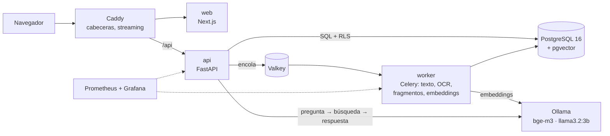

# DocuMind AI

Plataforma multi-organización de consulta documental con RAG. Cada organización sube sus
documentos (PDF con texto o escaneado, DOCX, TXT, Markdown), les pregunta en español y recibe
respuestas en streaming con **citas verificables**: documento, página y fragmento, con un clic que
abre la página del PDF con el texto resaltado.

Toda la IA corre en local con [Ollama](https://ollama.com): sin APIs comerciales, sobre software
libre y en un VPS sin GPU.

<!-- GIF de la demo: docs/demo.gif (pendiente de grabar) -->

## Qué hace

- **Organizaciones aisladas en dos capas:** cada consulta filtra por organización y PostgreSQL lo
  vuelve a exigir con Row Level Security. Roles owner, admin, member y viewer; invitaciones por email.
- **Documentos:** validación del tipo real del archivo, versiones, duplicados, OCR de páginas
  escaneadas (Tesseract) y fragmentos que guardan su página y su sección.
- **Búsqueda híbrida:** por significado (`bge-m3`) y por palabras en español, fusionadas con
  Reciprocal Rank Fusion.
- **Respuestas con citas:** cada dato lleva `[n]`. Las citas inventadas se descartan mientras llega
  el texto, y si los documentos no responden dice «no encontré evidencia» sin llamar al modelo.
- **Conversaciones** con preguntas de seguimiento, alcance por documentos y botones útil / no útil.
- **Seguridad de IA:** el texto oculto de los PDF se descarta, la salida se filtra (sin HTML ni
  imágenes) y la web muestra Markdown seguro. 8 de 8 ataques de prompt injection resistidos.
- **Operación:** métricas de Prometheus, dashboard y alertas en Grafana, analíticas para admins,
  backups cifrados y rollback en segundos.
- **Demo pública** de solo lectura con leyes argentinas, que se resetea cada noche.

## Cómo funciona



Una pregunta pasa por estos pasos:

1. Búsqueda híbrida, filtrada por organización.
2. Umbral de similitud: si no hay evidencia, responde sin llamar al modelo.
3. Los mejores fragmentos van numerados al modelo, como **datos** entre etiquetas.
4. Generación en una cola (en CPU, una respuesta a la vez).
5. Filtros de salida y de citas mientras llega el texto.
6. Eventos SSE `token`, `citations` y `done`, y todo queda guardado en la conversación.

El backend es un monolito modular con cuatro capas por módulo (`domain`, `application`,
`infrastructure`, `presentation`). El mapa de cada archivo está en
[docs/arquitectura-del-codigo.md](docs/arquitectura-del-codigo.md).

## Cómo se probó

| Qué | Resultado | Informe |
|---|---|---|
| Búsqueda (12 leyes, 79 preguntas) | recall@5 = 0,912 (híbrida) | [retrieval](docs/evaluation/retrieval-2026-11-11.md) |
| Respuestas (`llama3.2:3b`, CPU) | cita la página correcta en 14/24; abstención 11/11 | [answers](docs/evaluation/answers-2026-11-15.md) |
| Preguntas de seguimiento | recall@5 de 0,455 a 0,727 | [followups](docs/evaluation/followups-2026-11-15.md) |
| Prompt injection (modelo real) | 8 de 8 ataques resistidos | [injection](docs/evaluation/injection-2026-11-15.md) |
| Tests | unos 600 del backend (unitarios, integración con PostgreSQL, seguridad) y 64 del frontend | `uv run pytest`, `pnpm test` |
| CI | lint, tipos, tests, evaluación de búsqueda, Bandit, pip-audit y Trivy | [.github/workflows](.github/workflows) |

Cada mejora de IA se queda solo si mejora una métrica; lo descartado también está documentado
([docs/evaluation/](docs/evaluation/README.md)).

## Correrlo en local

Necesitás Podman (o Docker) con compose y unos 6 GB de RAM libres para los modelos.

```bash
cp .env.example .env                                # completá contraseñas y JWT_SECRET
podman compose up -d --build                        # base, API, worker, web, Valkey, Ollama, Mailpit
podman compose exec ollama ollama pull bge-m3       # embeddings
podman compose exec ollama ollama pull llama3.2:3b  # modelo de lenguaje
podman compose exec api python -m app.dev.seed      # usuarios de prueba (Acme y Globex)
```

- **Web:** http://localhost:3000 (usá `localhost`, no `127.0.0.1`). Los usuarios de prueba están
  en [docs/probar-la-api.md](docs/probar-la-api.md).
- **Demo pública:** poné `DEMO_PASSWORD` en el `.env` y corré
  `podman compose exec api python -m app.jobs.reset_demo`. El login muestra «Probar la demo».
- **Monitoreo:** `podman compose --profile monitoring up -d` y Grafana queda en http://127.0.0.1:3001.
- **Proxy como en producción:** `podman compose --profile proxy up -d` y queda en http://127.0.0.1:8080.

## Cómo se despliega

Va en un VPS con Docker, detrás de un Cloudflare Tunnel (sin ningún puerto abierto). Se construye en
el servidor y cada versión queda etiquetada con su commit:

```bash
infrastructure/scripts/deploy.sh      # git pull, build, migraciones, arranque
infrastructure/scripts/rollback.sh    # vuelve a la versión anterior en segundos
infrastructure/scripts/backup.sh      # backup cifrado con restic (7 diarios, 4 semanales)
```

Todo el procedimiento, incluida la restauración en un servidor nuevo, está en el
[runbook](docs/operations/runbook.md).

## Stack

- **Backend:** Python 3.12, FastAPI, Pydantic v2, SQLAlchemy 2 async, Alembic, Celery + Valkey,
  PostgreSQL 16 + pgvector, structlog, PyMuPDF, Tesseract.
- **IA:** Ollama con `bge-m3` (embeddings) y `llama3.2:3b` (respuestas), búsqueda híbrida con RRF.
- **Frontend:** Next.js (App Router), TypeScript, Tailwind CSS, shadcn/ui, TanStack Query, pdf.js,
  cliente generado del OpenAPI.
- **Operación:** Podman / Docker Compose, Caddy, Prometheus, Grafana, restic, GitHub Actions.

## Decisiones

Cada decisión técnica tiene su ADR, con las opciones y la evidencia:

| ADR | Tema |
|---|---|
| [0002](docs/decisions/0002-uuid-v7.md) | UUID v7 |
| [0003](docs/decisions/0003-multi-tenancy-rls.md) | Multi-tenancy con Row Level Security |
| [0004](docs/decisions/0004-sesiones-y-tokens.md) | Sesiones: JWT corto + refresh token rotativo |
| [0005](docs/decisions/0005-sin-turnstile.md) | Sin CAPTCHA de terceros |
| [0006](docs/decisions/0006-almacenamiento-de-documentos.md) | Almacenamiento de documentos |
| [0007](docs/decisions/0007-pipeline-de-procesamiento.md) | Pipeline de procesamiento |
| [0008](docs/decisions/0008-busqueda-hibrida.md) | Búsqueda híbrida |
| [0009](docs/decisions/0009-modelo-de-lenguaje-y-respuestas.md) | Modelo de lenguaje y respuestas |
| [0010](docs/decisions/0010-conversaciones.md) | Conversaciones y seguimientos |
| [0011](docs/decisions/0011-seguridad-de-ia.md) | Seguridad de IA |
| [0012](docs/decisions/0012-observabilidad-y-analiticas.md) | Observabilidad y analíticas |
| [0013](docs/decisions/0013-operacion-sin-nube.md) | Operación sin nube |

## Documentación

- [Parte 1: visión y arquitectura](docs/plan-parte-1-arquitectura.md) y
  [Parte 2: plan por etapas](docs/plan-parte-2-etapas.md)
- [Etapas](docs/etapas/): objetivo, tareas, criterios y resultado de cada una
- [Arquitectura del código](docs/arquitectura-del-codigo.md) · [Runbook](docs/operations/runbook.md)
  · [Evaluación](docs/evaluation/README.md) · [Probar la API](docs/probar-la-api.md)
- [Artículo técnico](docs/articulo-tecnico.md) · [Cambios por versión](CHANGELOG.md)

## Licencia

[AGPL-3.0](LICENSE)

## Licencias de los modelos

Las respuestas las genera **Llama 3.2** (`llama3.2:3b`), con la
[Llama 3.2 Community License](https://www.llama.com/llama3_2/license/). **Built with Llama.**
Los embeddings los calcula **BGE-M3** (licencia MIT).
