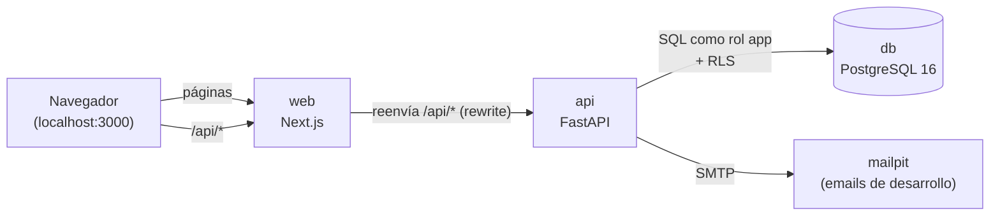
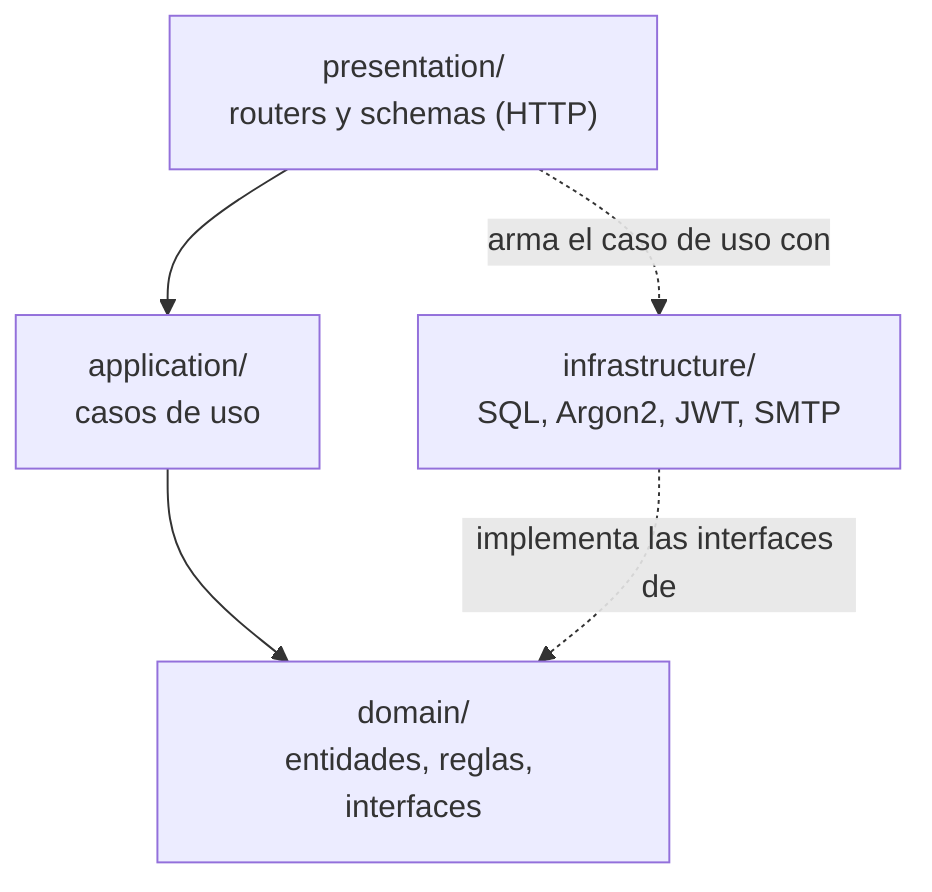
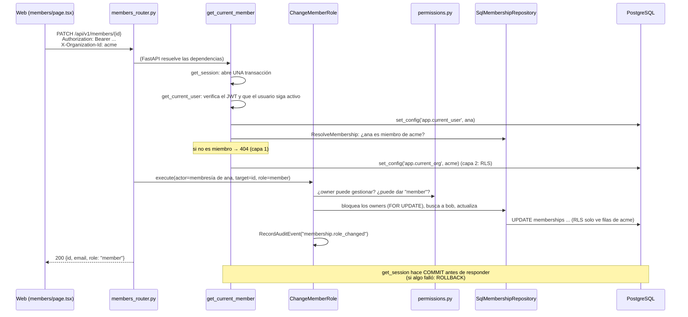
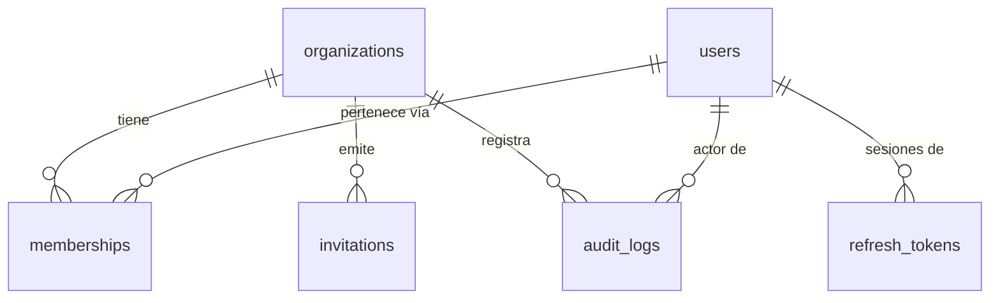
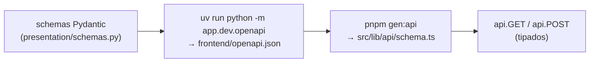
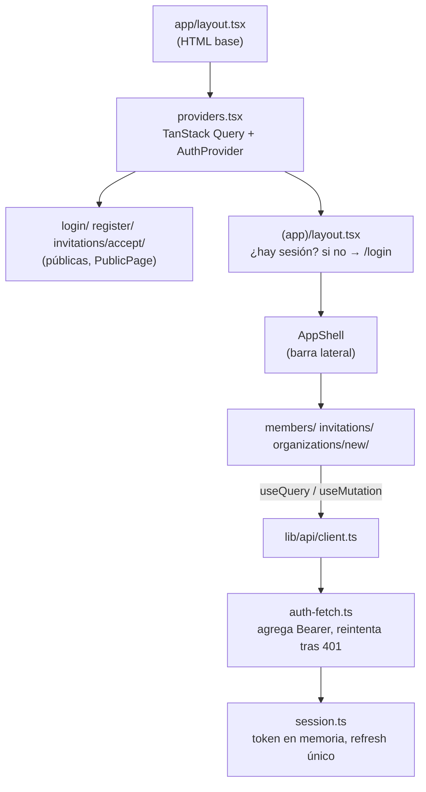
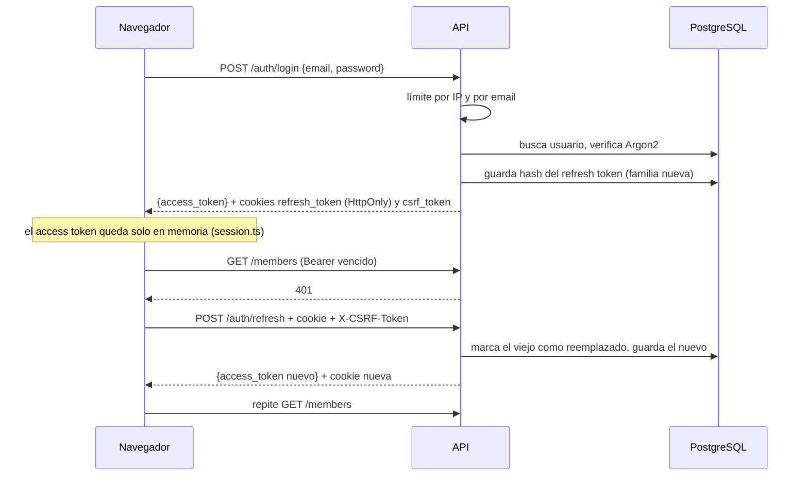
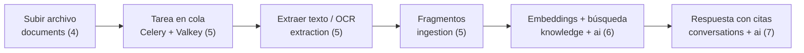

# Arquitectura del código

Mapa del código **tal como está hoy** (fin de la etapa 2): qué hace cada carpeta y cada archivo, y cómo
se comunican las piezas. El *diseño* completo del producto está en `plan-parte-1-arquitectura.md`;
este documento describe lo que ya existe. Se actualiza al cerrar cada etapa.

Las comparaciones con PHP/Dolibarr son para orientarse, no son equivalencias exactas.

---

## 1. Vista general

- El navegador **solo habla con la web** (`localhost:3000`). Las llamadas a `/api/...` las reenvía Next.js
  a la API. Por eso la cookie de sesión es "del mismo sitio" y no hace falta CORS.
- La API es la **única** que toca la base de datos. Toda la lógica de negocio vive en la API; la web
  solo muestra datos y decide qué botones mostrar.
- Los servicios los levanta `compose.yaml` (`podman compose up -d --build`). Además de los cuatro de la
  tabla, hay un servicio `migrate` que corre una vez: aplica las migraciones con el rol `migrator` y termina.

| Servicio | Imagen / origen | Puerto (solo en tu PC) | Para qué |
|---|---|---|---|
| `db` | `pgvector/pgvector:pg16` (PostgreSQL 16 con la extensión de vectores para la etapa 6) | `127.0.0.1:5432` | Datos. Roles `migrator` (dueño de las tablas) y `app` (la API, sujeto a RLS). |
| `api` | `infrastructure/containers/backend.Containerfile` | `127.0.0.1:8000` | La API. Arranca cuando `migrate` terminó. |
| `web` | `infrastructure/containers/frontend.Containerfile` | `127.0.0.1:3000` | La interfaz. |
| `mailpit` | `axllent/mailpit` | `127.0.0.1:8025` (web), `1025` (SMTP) | Atrapa los emails para verlos sin mandarlos de verdad. |

---

## 2. La raíz del repo

| Ruta | Qué es |
|---|---|
| `CLAUDE.md` | Reglas del proyecto para Claude Code y estado actual. |
| `README.md` | Presentación del proyecto y cómo arrancarlo. |
| `compose.yaml` | Entorno de desarrollo (los servicios de arriba, más `migrate`). |
| `.env.example` | Todas las variables de entorno con valores de ejemplo. El `.env` real no se commitea. |
| `.pre-commit-config.yaml` | Revisiones antes de cada commit: formato, ruff, mypy y detect-secrets (frena contraseñas). |
| `.github/workflows/` | CI: `backend.yml` (lint, tipos, tests con PostgreSQL) y `frontend.yml` (lint, tipos, tests, build). Ambos verifican que el contrato OpenAPI no quedó desactualizado. |
| `.github/dependabot.yml` | Avisa de actualizaciones de dependencias. |
| `backend/` | La API en Python. Sección 3. |
| `frontend/` | La web en Next.js. Sección 5. |
| `infrastructure/` | Todo lo que no es código de la app. Sección 7. |
| `docs/` | Planes, etapas, decisiones (ADR) y guías. Sección 8. |

---

## 3. Backend (`backend/`)

### 3.1 Las cuatro capas

El backend es un **monolito modular**: un solo programa dividido en módulos (`users`, `auth`,
`organizations`, `audit`...). Cada módulo tiene cuatro capas, y cada capa solo conoce a las de adentro:

| Capa | Contiene | Conoce FastAPI | Conoce SQL |
|---|---|---|---|
| `domain/` | Entidades (dataclasses), reglas puras, **interfaces** (`Protocol`) y errores | No | No |
| `application/` | Casos de uso: una clase por acción (`Login`, `ChangeMemberRole`...) con un método `execute` | No | No |
| `infrastructure/` | Implementaciones concretas: modelos SQLAlchemy, repositorios SQL, Argon2, JWT | No | Sí |
| `presentation/` | Routers, schemas Pydantic (forma del JSON), dependencias de FastAPI | Sí | No |

**En Dolibarr** una clase como `Societe` hace todo: tiene los datos, el SQL (`fetch`, `create`) y las reglas.
Acá eso está separado: `domain` tiene los datos y las reglas, `infrastructure` el SQL y `application`
la secuencia de pasos. Así las reglas se prueban sin base de datos (tests unitarios con *fakes*).

**Inyección de dependencias.** Un caso de uso no crea sus herramientas: las recibe en el constructor.
`ChangeMemberRole(memberships, audit, get_users, clock=...)` recibe "algo que guarda membresías",
no "el repositorio SQL". En producción le pasan `SqlMembershipRepository`; en los tests, un
`InMemoryMembershipRepository`. Quien los arma son las funciones `provide_*` de
`presentation/dependencies.py`.

**Reglas de dependencia entre módulos:** un módulo no toca las tablas de otro. Si `organizations`
necesita emails de usuarios, llama al caso de uso `users.application.GetUsersByIds`, no a la tabla `users`.
(Única excepción, consciente: las funciones `provide_*` de presentación arman los repositorios SQL de
`users` para pasárselos a esos casos de uso.)

### 3.2 Cómo viaja un pedido

Ejemplo: ana (owner) cambia el rol de bob a "Miembro".

Puntos clave:

- **Una transacción por pedido** (`infrastructure/database/session.py`): todo lo que hace el pedido
  se guarda junto o no se guarda nada.
- **El contexto de RLS vive dentro de esa transacción** (`set_config(..., true)`): al terminar,
  desaparece, y la conexión vuelve limpia al pool.
- **Los errores son clases** (`shared/errors.py` y `domain/errors.py` de cada módulo). Cada una sabe su
  código HTTP y su `code`; `core/exceptions.py` las convierte en
  `{"error": {"code", "message", "request_id"}}`.

### 3.3 `backend/app/` archivo por archivo

#### Arranque

| Archivo | Qué hace |
|---|---|
| `main.py` | `create_app()`: crea la app FastAPI, la conexión a la base, el mailer y el limitador de intentos (en `app.state`), registra los routers bajo `/api/v1` y los manejadores de errores. Es el punto de entrada (como `main.inc.php`). |

#### `core/`: lo que necesita cualquier pedido

| Archivo | Qué hace |
|---|---|
| `config.py` | `Settings`: lee y valida **todas** las variables de entorno (base, JWT, SMTP, límites). Si falta una obligatoria, la app no arranca. Como `conf.php`, pero tipado. |
| `dependencies.py` | Dependencias comunes: `SessionDep` (sesión de base del pedido), `SettingsDep`, `ClientIpDep` (IP del cliente). |
| `exceptions.py` | Convierte cualquier error en el JSON estándar. Agrega `Retry-After` en los 429. Los errores inesperados devuelven 500 sin mostrar detalles internos. |
| `request_context.py` | Middleware que asigna un `request_id` a cada pedido (o respeta el que llega) y lo devuelve en `X-Request-ID`. |
| `logging.py` | Logs JSON con structlog; cada línea lleva el `request_id`. |
| `health.py` | `GET /health` (el proceso vive) y `GET /ready` (además, la base responde). |
| `pagination.py` | Paginación por cursor: `?limit=&cursor=` → `{items, next_cursor}`. |
| `mail.py` | `BackgroundMail`: encola emails para mandarlos **después** de responder (el pedido no espera al SMTP). `OutgoingMailDep`. |
| `rate_limits.py` | Los límites de intentos (login por IP y por email, registro por IP, aceptar invitación por usuario) como dependencias de FastAPI. |

#### `shared/`: piezas chicas que usan todos

| Archivo | Qué hace |
|---|---|
| `errors.py` | Errores base: `NotFoundError` (404), `ForbiddenError` (403), `ConflictError` (409), `UnauthorizedError` (401), `TooManyRequestsError` (429)... Los módulos heredan de estos. |
| `ids.py` | `new_id()`: UUID v7 (ordenables por fecha, ADR 0002). |
| `secure_tokens.py` | `generate_token()` (256 bits al azar) y `hash_token()` (SHA-256). Se guardan hashes, nunca tokens. |
| `tenancy.py` | Interfaz `TenantContext`: "fijá el usuario / la organización activa". La implementa `infrastructure/database/tenant.py`. |
| `mail.py` | Interfaces `Mailer` y `OutgoingMail`, y el tipo `EmailMessage`. |
| `rate_limit.py` | Interfaz `RateLimiter` y el tipo `RateLimit(limit, window)`. |

#### `infrastructure/`: implementaciones compartidas

| Archivo | Qué hace |
|---|---|
| `database/session.py` | Motor async de SQLAlchemy y `get_session`: abre la transacción del pedido, hace COMMIT si todo salió bien y ROLLBACK si no. |
| `database/tenant.py` | `SqlTenantContext`: ejecuta `set_config('app.current_user' / 'app.current_org', ..., true)`. Es lo que leen las políticas RLS. |
| `database/base.py` | Clase base de los modelos SQLAlchemy (convención de nombres de índices y claves). |
| `database/models.py` | Importa todos los modelos para que Alembic los vea. |
| `mail/smtp.py` | `SmtpMailer` (manda por SMTP, a Mailpit en desarrollo) y `LoggingMailer` (si no hay SMTP configurado: solo anota destinatario y asunto en el log). |
| `rate_limit.py` | `InMemoryRateLimiter`: cuenta intentos en una ventana deslizante, en memoria. Alcanza con una sola instancia de la API. |
| `storage/`, `queue/`, `workers/` | Vacías: archivos (etapa 4), Celery + Valkey (etapa 5). |

#### `modules/users/`: cuentas

| Archivo | Qué hace |
|---|---|
| `domain/entities.py` | `User`: id, email normalizado, hash de contraseña, activo, fechas. |
| `domain/passwords.py` | Interfaz `PasswordHasher` y la regla de largo mínimo (10). |
| `domain/repository.py` | Interfaz `UserRepository`: qué consultas existen (por id, por email, varios ids, agregar). |
| `domain/errors.py` | `InvalidEmailError`, `WeakPasswordError`, `EmailAlreadyRegisteredError`. |
| `application/create_user.py` | Valida, hashea la contraseña y guarda el usuario. |
| `application/verify_credentials.py` | ¿Email y contraseña correctos? Siempre tarda lo mismo, exista o no el email (no revela qué cuentas existen). |
| `application/get_user.py` | `GetActiveUser`: el usuario, solo si sigue activo. |
| `application/get_users_by_ids.py` | Varios usuarios de una vez (para mostrar emails en la lista de miembros). |
| `application/find_user_by_email.py` | Busca por email (para saber si un invitado ya es miembro). |
| `infrastructure/argon2_hasher.py` | Hashea con Argon2id (como `password_hash()` de PHP, pero más resistente a ataques con GPU). |
| `infrastructure/models.py` | Tabla `users`. |
| `infrastructure/sql_repository.py` | `SqlUserRepository`: las consultas SQL. |

#### `modules/auth/`: sesiones (ADR 0004)

| Archivo | Qué hace |
|---|---|
| `domain/tokens.py` | Qué lleva el token de acceso (`AccessClaims`: usuario, vencimiento) y la interfaz para firmarlo y leerlo. |
| `domain/refresh_tokens.py` | `RefreshToken`: el token largo, con su *familia* (todos los que salen de un mismo login) y si ya fue reemplazado. |
| `domain/errors.py` | `InvalidCredentialsError`, `InvalidTokenError`, `RefreshTokenReuseError`... |
| `application/register.py` | Crea usuario + organización (quedás owner), **o** usuario + aceptar invitación. Todo en la misma transacción. |
| `application/login.py` | Revisa el límite por email, verifica credenciales, audita y emite la sesión. |
| `application/issue_session.py` | Emite el par: token de acceso (JWT, 15 min) + token de refresco (al azar, 14 días; se guarda su hash). |
| `application/refresh_session.py` | Cambia un token de refresco por uno nuevo (**rotación**). Si llega uno ya usado, alguien lo copió: revoca toda la familia. |
| `application/logout.py` | Revoca la familia del token actual. |
| `infrastructure/jwt_codec.py` | Firma y verifica los JWT (HS256, con emisor, audiencia y vencimiento). |
| `infrastructure/models.py` | Tabla `refresh_tokens`. |
| `infrastructure/sql_repository.py` | Consultas de `refresh_tokens` (con bloqueo de fila al rotar). |
| `presentation/router.py` | `POST /auth/register`, `/login`, `/refresh`, `/logout` y `GET /auth/me`. Revisa el campo trampa (honeypot). |
| `presentation/schemas.py` | Forma del JSON de entrada y salida (`RegisterRequest`, `LoginRequest`, `TokenResponse`...). |
| `presentation/cookies.py` | Pone y borra la cookie `refresh_token` (HttpOnly, Secure, SameSite=Lax, solo para `/api/v1/auth`) y la cookie `csrf_token`. |
| `presentation/csrf.py` | Protección CSRF: rechaza pedidos de otro origen y exige que el header `X-CSRF-Token` coincida con la cookie. |
| `presentation/dependencies.py` | Arma los casos de uso (`provide_*`) y define **`CurrentUserDep`** (¿quién sos?) y **`CurrentMemberDep`** (¿sos miembro de la organización del header?). |

#### `modules/organizations/`: empresas, miembros e invitaciones (ADR 0003)

| Archivo | Qué hace |
|---|---|
| `domain/entities.py` | `Organization` (nombre, slug) y validación del slug. |
| `domain/roles.py` | Los 4 roles y su orden: owner > admin > member > viewer. |
| `domain/permissions.py` | **Las reglas de autorización**: qué puede hacer cada rol (`ensure_permission`), a quién puede gestionar (`can_manage`), qué rol puede dar (`can_grant`, `can_invite_as`) y que siempre quede un owner (`ensure_an_owner_remains`). |
| `domain/membership.py` | `Membership`: usuario + organización + rol. |
| `domain/invitation.py` | `Invitation`: email, rol, hash del token, vencimiento (7 días) y estado (`pending`, `expired`, `accepted`, `revoked`). |
| `domain/repository.py` | Interfaces de los repositorios de organizaciones, membresías e invitaciones. |
| `domain/errors.py` | `OrganizationNotFoundError` (404), `PermissionDeniedError` (403), `LastOwnerError` (409), `InvitationExpiredError`... |
| `application/create_organization.py` | Crea la organización y te deja como owner. |
| `application/get_organization.py` | `GetOrganization` (una, con mi rol) y `ListMyOrganizations` (todas las mías). |
| `application/resolve_membership.py` | ¿Este usuario es miembro de esta organización? Si no → 404. Lo usa `CurrentMemberDep`. |
| `application/manage_members.py` | `ListMembers`, `ChangeMemberRole`, `RemoveMember`. Orden de los controles: permiso (403) → existe (404) → rango (403) → último owner (409). |
| `application/invitations.py` | `CreateInvitation` (genera el token, guarda el hash, arma el link y encola el email), `ListInvitations`, `RevokeInvitation`, `AcceptInvitation`. |
| `infrastructure/models.py` | Tablas `organizations`, `memberships`, `invitations`. |
| `infrastructure/sql_repository.py` | Consultas SQL. `count_owners_for_update` bloquea las filas de los owners para que dos pedidos simultáneos no dejen la empresa sin owner. |
| `presentation/router.py` | `GET/POST /organizations` y `GET /organizations/{id}`. |
| `presentation/members_router.py` | `GET /members`, `PATCH /members/{id}`, `DELETE /members/{id}`. |
| `presentation/invitations_router.py` | `POST/GET /invitations`, `DELETE /invitations/{id}`, `POST /invitations/accept`. |
| `presentation/schemas.py` | JSON de entrada y salida (`MemberRead`, `InvitationCreate`, `CreatedInvitationRead`...). |
| `presentation/dependencies.py` | Arma los casos de uso de este módulo. |

#### `modules/audit/`: registro de acciones

| Archivo | Qué hace |
|---|---|
| `domain/entities.py` | `AuditEvent` y la lista de acciones (`AuditAction`: login, login fallido, cambio de rol, invitación...). |
| `domain/repository.py` | Interfaz: solo `add`. |
| `application/record_audit_event.py` | `RecordAuditEvent`: lo llaman los otros módulos para dejar constancia. |
| `infrastructure/models.py`, `sql_repository.py` | Tabla `audit_logs`. El rol `app` solo puede insertar: ni la API puede borrar o editar el historial. |

#### Módulos vacíos (se llenan más adelante)

| Carpeta | Etapa | Para qué |
|---|---|---|
| `modules/documents/` | 4 | Subir, listar, descargar y borrar documentos. |
| `modules/ingestion/`, `modules/extraction/` | 5 | Pipeline: extraer texto (PyMuPDF, OCR) y partir en fragmentos. |
| `modules/knowledge/` | 6 | Fragmentos con embeddings y búsqueda híbrida. |
| `modules/conversations/` | 7–8 | Chat con citas e historial. |
| `modules/analytics/` | 10 | Métricas de uso. |
| `ai/` | 6–9 | Todo lo de IA, detrás de interfaces (`LLMProvider`, `EmbeddingProvider`): los módulos nunca hablan con Ollama directo. |

#### `dev/`: solo para desarrollo

| Archivo | Qué hace |
|---|---|
| `seed.py` | Carga usuarios de prueba (Acme y Globex). Se niega a correr fuera de `APP_ENV=development`. |
| `openapi.py` | Exporta el contrato de la API (`frontend/openapi.json`) sin necesitar base de datos. |

### 3.4 Base de datos

| Archivo | Qué hace |
|---|---|
| `alembic.ini`, `migrations/env.py` | Configuración de Alembic (las migraciones corren con el rol `migrator`). |
| `migrations/versions/0001_initial_organizations.py` | Tabla `organizations`. |
| `migrations/versions/0002_identity_tables.py` | `users`, `memberships`, `refresh_tokens`, `audit_logs`, `invitations`. |
| `migrations/versions/0003_row_level_security.py` | Activa RLS (`ENABLE` + `FORCE`) y crea las políticas y las funciones `current_org_id()` / `current_user_id()`. Da permisos al rol `app`. |

**Quién ve qué (RLS):** con `app.current_org = X`, `memberships`, `invitations` y `audit_logs` solo
devuelven filas de X, aunque la consulta se olvide del `WHERE`. `users` y `refresh_tokens` no tienen
RLS (no son datos de una empresa; ver ADR 0003).

### 3.5 Tests (`backend/tests/`)

| Carpeta / archivo | Qué prueba |
|---|---|
| `fakes.py` | Repositorios en memoria y relojes falsos para los tests unitarios. |
| `conftest.py`, `db.py` | Configuración común: base de tests, limpieza entre tests. |
| `unit/` | Reglas y casos de uso **sin base de datos** (rápidos): permisos, tokens, invitaciones, límites, config. |
| `integration/` | La API de verdad contra PostgreSQL: registro, login, miembros, invitaciones, límites, seed. `api_helpers.py` y `factories.py` arman escenarios (por ejemplo, Acme con un miembro por rol). |
| `security/` | Aislamiento: RLS (`test_rls.py`), una empresa no ve datos de otra (`test_tenant_isolation.py`), el rol `app` no puede saltarse RLS (`test_database_roles.py`). |

---

## 4. Contrato entre backend y frontend

- Los schemas de la API generan `openapi.json`, y de ahí sale `schema.ts` con los tipos de TypeScript.
- Si el backend cambia un campo y no se regenera, **TypeScript no compila** y el CI falla.
- Equivalente en PHP: es como si los formularios supieran de antemano qué columnas acepta cada endpoint.

---

## 5. Frontend (`frontend/`)

### 5.1 Cómo se arma una página

### 5.2 Archivo por archivo

#### `src/app/`: cada carpeta es una URL

| Ruta | URL | Qué hace |
|---|---|---|
| `layout.tsx` | todas | HTML base, idioma y título. |
| `providers.tsx` | todas | Activa TanStack Query (caché de pedidos) y `AuthProvider` (sesión). |
| `globals.css` | todas | Tailwind y los colores del tema (claro y oscuro). |
| `page.tsx` | `/` | Redirige a `/members`. |
| `login/page.tsx` | `/login` | Formulario de entrada. Después vuelve a la página de `?next=`. |
| `register/page.tsx` | `/register` | Crea cuenta + empresa. |
| `invitations/accept/page.tsx` | `/invitations/accept#...` | Lee el token del `#` una sola vez, lo borra de la barra de direcciones y deja aceptar (con cuenta existente o nueva). |
| `(app)/layout.tsx` | zona privada | Sin sesión → `/login?next=...`. Con sesión → `AppShell`. Los paréntesis agrupan sin agregar nada a la URL. |
| `(app)/members/page.tsx` | `/members` | Lista de miembros, cambio de rol y quitar. |
| `(app)/invitations/page.tsx` | `/invitations` | Invitar, ver y revocar invitaciones. |
| `(app)/organizations/new/page.tsx` | `/organizations/new` | Crear otra organización. |

#### `src/components/`

| Archivo | Qué hace |
|---|---|
| `ui/*` | Componentes base de shadcn/ui (botón, input, tabla, tarjeta, alerta, select). |
| `brand.tsx` | Logo e ilustración del login (SVG dibujado a mano). |
| `form.tsx` | `Field` (label + input), `ErrorMessage` y `PublicPage` (pantalla dividida del login). |
| `app-shell.tsx` | Barra lateral: selector de organización, menú, usuario y "Salir". |
| `people.tsx` | `Avatar` (iniciales), `RoleBadge` (rol con color) y `PageHeader`. |
| `members-table.tsx` | Tabla de miembros; muestra controles solo donde la API los permitiría. |
| `login-form.tsx` | Formulario de login (se reusa en aceptar invitación). |
| `honeypot.tsx` | Campo invisible contra bots (ADR 0005). |

#### `src/lib/`

| Archivo | Qué hace |
|---|---|
| `api/schema.ts` | **Generado**: tipos de todos los endpoints. No se edita a mano. |
| `api/client.ts` | Cliente `api` tipado, `unwrap` (devuelve los datos o lanza `ApiError`), `errorMessage`, `inOrganization(id)` (agrega el header `X-Organization-Id`). |
| `api/session.ts` | `SessionStore`: el token de acceso **solo en memoria** y `refresh()` con una sola renovación aunque la pidan varios pedidos a la vez. |
| `api/auth-fetch.ts` | Envuelve `fetch`: agrega `Authorization: Bearer`, y ante un 401 renueva una vez y repite el pedido. |
| `api/organization-store.ts` | Recuerda la organización elegida (localStorage) y avisa cuando cambia. |
| `auth.tsx` | `AuthProvider` y `useAuth()`: al abrir la web intenta renovar la sesión con la cookie; `startSession`, `logout`. |
| `organizations.tsx` | `useOrganizations()` y `useActiveOrganization()` (lee la organización elegida con `useSyncExternalStore`). |
| `roles.ts` | Qué botones mostrar según el rol. **La regla real la aplica la API** (`permissions.py`). |
| `slug.ts`, `invitation-link.ts` | Generar el slug desde el nombre; leer el `#organization=..&token=..` del link. |

#### `src/features/`

Vacía: `documents/` (etapa 4), `chat/` (etapa 7), `analytics/` (etapa 10).

#### Configuración

| Archivo | Qué hace |
|---|---|
| `next.config.ts` | Salida `standalone` (imagen chica), **reenvío de `/api/*` a la API**, cabeceras de seguridad. |
| `package.json`, `pnpm-lock.yaml`, `.npmrc` | Dependencias con versión exacta. |
| `tsconfig.json`, `eslint.config.mjs` | TypeScript estricto y lint. |
| `vitest.config.ts`, `vitest.setup.ts` | Tests del frontend (`*.test.ts(x)` junto a cada archivo). |

---

## 6. Flujos completos

### 6.1 Login y renovación de la sesión

Si se recarga la página, el token en memoria se pierde: `AuthProvider` llama a `/auth/refresh`
con la cookie y la sesión sigue. Si alguien usa un refresh token ya reemplazado, la API revoca
toda la familia (las dos copias dejan de servir).

### 6.2 Invitación

1. Un owner o admin crea la invitación: `CreateInvitation` genera un token al azar, **guarda solo su hash**
   y arma el link `.../invitations/accept#organization=<id>&token=<token>`. El email se manda después de
   responder (`BackgroundMail` → SMTP → Mailpit).
2. La persona abre el link. La página lee el `#` (que nunca viaja al servidor ni queda en logs) y lo borra
   de la barra de direcciones.
3. Si no tiene cuenta, `POST /auth/register` con `invitation`; si tiene, `POST /invitations/accept`.
   `AcceptInvitation` fija la organización del link, busca el hash **dentro** de ella, verifica que
   el email coincida y que no esté vencida, crea la membresía y marca la invitación como aceptada.
   Todo en una transacción: si algo falla, no queda ni la cuenta a medias.

---

## 7. Infraestructura (`infrastructure/`)

| Ruta | Qué hay |
|---|---|
| `containers/backend.Containerfile` | Imagen de la API en dos etapas: instala dependencias con uv y copia a la final solo el entorno y el código (Python 3.12 slim, usuario `app` sin root). |
| `containers/frontend.Containerfile` | Imagen de la web: build de Next.js en una etapa, y en la final solo la salida `standalone` con Node, usuario sin root. |
| `scripts/db-init/roles.sh` | Se ejecuta al crear la base por primera vez: crea los roles `migrator` y `app` con sus permisos. |
| `proxy/` | Vacía: Caddy (etapa 3). |
| `tunnel/` | Vacía: Cloudflare Tunnel (etapa 3). |
| `monitoring/` | Vacía: Prometheus y Grafana (etapa 10). |

---

## 8. Documentación (`docs/`)

| Ruta | Qué hay |
|---|---|
| `plan-parte-1-arquitectura.md` | Qué se construye (diseño completo). |
| `plan-parte-2-etapas.md` | En qué orden. |
| `etapas/etapa-NN.md` | Alcance, tareas y criterios de cada etapa, con su resultado al cerrarla. |
| `decisions/NNNN-*.md` | ADR: decisiones técnicas con sus alternativas (UUID v7, RLS, tokens, sin Turnstile). |
| `probar-la-api.md` | Usuarios de prueba y qué probar a mano. |
| `arquitectura-del-codigo.md` | Este documento. |
| `evaluation/`, `operations/` | Vacías: informes de evaluación de la IA (etapa 6+) y runbooks (etapa 11). |

---

## 9. Cómo crece

Cada etapa nueva suma un módulo con las mismas cuatro capas y, si guarda datos de una empresa,
una tabla con `organization_id` + política RLS + tests de aislamiento. Lo que viene:

